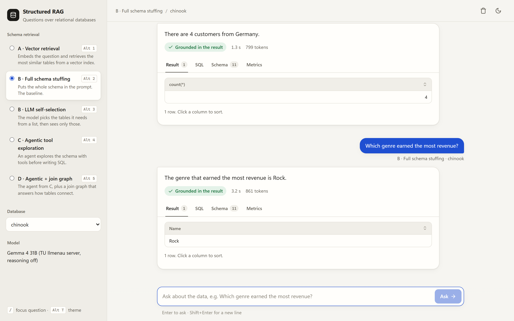

# RAG using Structured Database

Ask questions in plain English about a relational database. The system retrieves the relevant
part of the schema, has an LLM write SQL, runs that SQL read-only, and answers from the result
rows, with a check that every value in the answer appears in those rows.

This repository is the runnable companion to the master's thesis *Extending RAG with Structured
Databases* (TU Ilmenau). It contains the web interface, its local HTTP API, the full retrieval
and generation pipeline, the databases of the thesis, and all 346 thesis questions with gold
SQL. The model is **Gemma 4 31B on the TU Ilmenau DBIS server, with reasoning switched off**.

| Benchmark | Databases | Questions | In this repo? |
|---|---|---|---|
| **Chinook** (music store) | 1 database, 11 tables | 25 | Yes: `data/chinook.sqlite` |
| **TPC-H**, scale factor 0.01 | 1 database, 8 tables | 22 (the TPC-H queries) | Yes: `data/tpch_sf001.sqlite` |
| **Spider 1.0**, dev sample | 20 databases (of 166) | 299 | Questions yes. Databases: download them yourself ([how](#optional-add-the-spider-databases)) |

The thesis ran Chinook and TPC-H with every model and Spider with Gemma only. This repository
uses Gemma for all three.

**Contents:**
[Configurations](#the-five-configurations) ·
[Quick start](#quick-start) ·
[Questions](#all-thesis-questions) ·
[Spider](#optional-add-the-spider-databases) ·
[Offline check](#check-the-installation-without-the-llm) ·
[Reproducing](#notes-on-reproducing-thesis-numbers) ·
[Layout](#repository-layout) ·
[Data sources](#data-sources) ·
[Security](#security) ·
[Licence](#licence)



## The five configurations

They differ only in how the schema reaches the model. You can switch between them in the UI.

| UI label | What the model sees before writing SQL |
|---|---|
| **A · Vector retrieval** | The *k* = 5 tables whose descriptions are most similar to the question (ChromaDB, all-MiniLM-L6-v2) |
| **B · Full schema stuffing** ($B_1$ in the thesis) | The DDL of every table |
| **B · LLM self-selection** ($B_2$) | The table names; the model picks the tables, then gets their DDL |
| **C · Agentic tool exploration** | Nothing up front; a ReAct agent calls `list_tables`, `describe_table`, `sample_rows` |
| **D · Agentic + join graph** | As C, plus `find_join_path` and `get_related_tables` over the foreign-key graph |

All five then share the same steps: up to two SQL repair attempts, the answer generator and the grounding check.

---

## Quick start

You need **Python 3.11 or newer** (tested on 3.13), **Git**, and an **API key for the TU Ilmenau
DBIS LLM server**. You do not need Node.js, because the built web page is included.
Chinook and TPC-H work right away. For Spider, also follow
[Optional: add the Spider databases](#optional-add-the-spider-databases), either before or after
these steps.

### 1. Get the code

```bash
git clone https://github.com/shrikant-d/RAG-using-Structured-Database.git
cd RAG-using-Structured-Database
```

### 2. Create a virtual environment and install the dependencies

Windows (PowerShell):

```powershell
python -m venv .venv
.venv\Scripts\Activate.ps1
pip install -r requirements.txt
```

macOS / Linux:

```bash
python3 -m venv .venv
source .venv/bin/activate
pip install -r requirements.txt
```

### 3. Add your API key

Copy the template:

```bash
cp .env.example .env          # Windows: copy .env.example .env
```

Then open `.env` and paste your key after `TUI_LLM_API_KEY=`. Create the key in the server's
Open WebUI: **Settings → Account → API keys**. Leave `TUI_REASONING_EFFORT=none` as it is,
which keeps Gemma's reasoning off.

`.env` is listed in `.gitignore`. The key stays in the Python process and is never sent to
the browser.

### 4. Start the app

```bash
python -m webui.server
```

### 5. Open the page

Go to **http://127.0.0.1:8600**.

1. In the sidebar, pick a **Schema retrieval** configuration (each one says what it puts in
   front of the model) and a **Database**: `chinook`, `tpch_sf001`, or one of the Spider
   databases once Spider is downloaded. The model is fixed to Gemma 4 31B. On a narrow window
   the sidebar opens from the button at the top left.
2. Type a question and press **Enter**.
3. Each answer says whether it is grounded in the result. The tabs under it hold the evidence:
   - **Result**: the rows, sortable by column.
   - **SQL**: the executed query, plus the original query if a repair changed it.
   - **Schema**: the tables the configuration put in front of the model.
   - **Agent steps** (C and D only): every tool call with its input and output.
   - **Metrics**: latency, tool calls, repairs, tokens.

Keyboard shortcuts: `/` focuses the question box, `Alt+1`…`Alt+5` switch the configuration,
and `Alt+T` toggles light/dark.

### Questions to try

| Database | Question |
|---|---|
| chinook | How many tracks belong to the Jazz genre? |
| chinook | Which artist earned the most revenue from track sales? |
| chinook | Which media type is used by the most tracks that appear on the Music playlist? |
| tpch_sf001 | How many customers are there in each market segment? |
| tpch_sf001 | Which nation has the most suppliers? |
| spider/concert_singer | How many singers do we have? |
| spider/world_1 | Which continent is Anguilla in? |
| spider/car_1 | Which of the countries has the most car makers? List the country name. |

### All thesis questions

Every question the thesis evaluates is in **[`questions/sample_questions.txt`](questions/sample_questions.txt)**,
a plain-text list grouped by database. Each heading names the database to pick in the UI, and
each line reads `[id] (difficulty) question`, so you can copy a question into the UI. The gold
SQL for each question is in the JSON file named in the heading.

| Set | UI database | File | Questions | easy / medium / hard / extra |
|---|---|---|---|---|
| Chinook (music store, 11 tables) | `chinook` | [`questions/chinook.json`](questions/chinook.json) | 25 | 6 / 8 / 6 / 5 |
| TPC-H SF 0.01 (the 22 TPC-H queries, 8 tables) | `tpch_sf001` | [`questions/tpch.json`](questions/tpch.json) | 22 | 3 / 7 / 10 / 2 |
| Spider dev sample, 20 databases | `spider/<name>` | [`questions/spider/<name>.json`](questions/spider/) | 299 | 72 / 129 / 50 / 48 |

The difficulty tiers follow Spider's taxonomy, which depends on the number of joins and the
nesting of the query. The Spider questions need the Spider download described below. That
sample is drawn from the Spider 1.0 dev set, stratified by its official hardness levels, with
seed 2026; `questions/spider/sample_manifest.json` lists the question ids.

Each JSON file has this shape (gold SQL shortened):

```json
{
  "db_id": "chinook",
  "questions": [
    {"id": 16, "difficulty": "hard",
     "question": "Which artist earned the most revenue from track sales?",
     "gold_sql": "SELECT ar.Name FROM InvoiceLine il JOIN Track t ON ... LIMIT 1"}
  ]
}
```

To check an answer by hand, open the **SQL** and **Result** tabs under the answer and run the
`gold_sql` against the same database. Any SQLite client works, for example
`sqlite3 data/chinook.sqlite`. Matching *result sets*, not matching SQL text, is the thesis'
correctness criterion.

**Note on the TPC-H questions.** They follow the official TPC-H wording, so they are long. A
few substitution values were changed so that each query returns a non-empty result at
SF 0.01.

---

## Optional: add the Spider databases

The thesis also uses 20 databases from the **Spider 1.0** benchmark (Yu et al., 2018).
Spider is licensed CC BY-SA 4.0 and is **not included** in this repository. Download it yourself:

1. Open the Spider page, https://yale-lily.github.io/spider, and click **Spider Dataset** under
   *Getting Started*. The link goes to Google Drive:
   https://drive.google.com/file/d/1403EGqzIDoHMdQF4c9Bkyl7dZLZ5Wt6J/view
   It downloads `spider_data.zip`, which is about 200 MB.
2. Create the folder `data/spider/` in this repository.
3. Unzip `spider_data.zip` into it. The result must look like this:

   ```
   data/spider/spider_data/
   ├── database/
   │   ├── concert_singer/concert_singer.sqlite
   │   ├── world_1/world_1.sqlite
   │   └── ...           (166 database folders)
   ├── dev.json
   ├── tables.json
   └── ...
   ```

   Windows (PowerShell), from the repository root:

   ```powershell
   Expand-Archive "$HOME\Downloads\spider_data.zip" -DestinationPath data\spider
   ```

   macOS / Linux:

   ```bash
   mkdir -p data/spider && unzip ~/Downloads/spider_data.zip -d data/spider
   ```

   If you have a `__MACOSX/` folder next to `spider_data/`, you can delete it.
4. Restart `python -m webui.server`. The **Database** list now shows `spider/<name>` entries
   for all 166 databases.

The server finds the files only at `data/spider/spider_data/database/<name>/<name>.sqlite`.
If no `spider/` entries appear, check that the path has exactly this shape, without an extra
folder level. `data/spider/` is gitignored, so the download is never committed.

The thesis evaluates these 20 databases:
`battle_death`, `car_1`, `concert_singer`, `course_teach`, `cre_Doc_Template_Mgt`,
`dog_kennels`, `employee_hire_evaluation`, `flight_2`, `museum_visit`, `network_1`,
`orchestra`, `pets_1`, `poker_player`, `real_estate_properties`, `singer`,
`student_transcripts_tracking`, `tvshow`, `voter_1`, `world_1`, `wta_1`.
Their questions and gold SQL are in `questions/spider/<name>.json`, one file per database.
The thesis ran Spider with Gemma only.

---

## Check the installation without the LLM

These checks need neither the API key nor the network. They cover:
- Chinook and TPC-H load; Spider is not needed;
- write statements are refused;
- the database files are opened read-only;
- the API's input checks work.

```bash
pip install pytest httpx
python -m pytest tests
```

## Notes on reproducing thesis numbers

- **This is the interactive interface, not the benchmark harness.** It uses the same pipeline
  functions with temperature 0, but it allows two repair attempts. Answers and SQL should
  match the thesis' reasoning-off runs. Latency depends on the load on the shared server.
- **The first question under configuration A takes longer.** ChromaDB downloads its embedding
  model (about 80 MB) once and builds a local index in `.chroma/`.
- **Spider.** The thesis' Spider numbers come from the 20 databases listed above with Gemma. The
  interface also offers the other 146 Spider databases, which the thesis did not evaluate.
- **Each question runs alone.** The server answers one question at a time, so a second tab
  waits for the first.

## Repository layout

```
core/          SQL generation, execution with the read-only guard, repair loop,
               answer generation, grounding check, LLM client (core/llm.py)
paths/         the five schema-retrieval configurations (registry.py builds them)
db/            database helpers; build_tpch.py regenerates the TPC-H database
data/          chinook.sqlite, tpch_sf001.sqlite (+ spider/ after you download it)
webui/         server.py (FastAPI) and frontend/ (React + Vite; dist/ is the built page)
questions/     thesis question sets with gold SQL (Chinook, TPC-H, Spider sample)
tests/         offline smoke tests
```

## Optional: change the frontend

You need Node.js 20 or newer for this.

```bash
cd webui/frontend
npm ci
npm run dev       # http://localhost:5173, forwards /api to the Python server on :8600
npm run build     # writes webui/frontend/dist, which python -m webui.server serves
```

## Optional: regenerate the TPC-H database

```bash
pip install duckdb
python db/build_tpch.py --sf 0.01
```

This uses DuckDB's `tpch` extension, which implements the official `dbgen` algorithm, and adds
the primary and foreign keys from the TPC-H specification. Configuration D builds its join
graph from those foreign keys.

## Data sources

- **Chinook**: sample music-store database by Luis Rocha,
  [lerocha/chinook-database](https://github.com/lerocha/chinook-database) (MIT licence).
- **TPC-H**: the schema and data generator are from the
  [TPC-H benchmark](https://www.tpc.org/tpch/). The data was generated at SF 0.01 with DuckDB's
  `tpch` extension. Results from this repository are not TPC-H benchmark results.
- **Spider 1.0**: Yu et al., *Spider: A Large-Scale Human-Labeled Dataset for Complex and
  Cross-Domain Semantic Parsing and Text-to-SQL Task*, EMNLP 2018,
  [yale-lily.github.io/spider](https://yale-lily.github.io/spider) (CC BY-SA 4.0). The databases
  are not redistributed here. `questions/spider/` holds a sample of its dev-set questions and gold
  SQL, under the same licence.

## Security

- The server binds to `127.0.0.1` only and refuses requests whose `Host` header is not
  `127.0.0.1` or `localhost`. This guards against DNS rebinding.
- Generated SQL passes two independent guards:
  - a SELECT-only check that rejects multiple statements and data-modifying CTEs;
  - SQLite connections opened in read-only mode, for Chinook, TPC-H and every Spider database.
- The API key is read from `.env` on the server side. It never appears in a response, and
  `.env` is gitignored.
- Questions are limited to 2,000 characters, and the API documentation routes are disabled.
- `pip-audit` reports advisories against `chromadb`. All of them concern Chroma's
  HTTP server mode. This project uses Chroma embedded in the process (`PersistentClient`)
  and opens no Chroma port, so none of them applies. `npm audit` reports no
  vulnerabilities.

Do not expose this server to a network: it is a local, single-user research tool.

## Licence

Code: [MIT](LICENSE). Chinook, TPC-H and the Spider questions in `questions/spider/` keep the terms
of their sources (see [Data sources](#data-sources)). The Spider databases are not redistributed.
